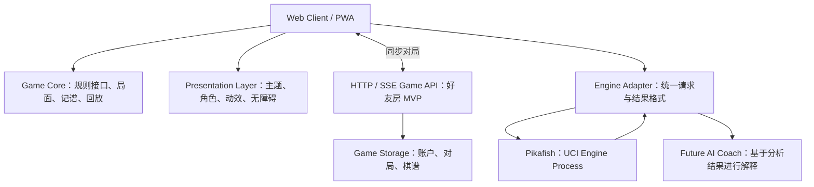

# NinePalace 项目说明

> 项目状态：v0.1 本机人机原型已可用；v0.2 局域网好友房 MVP 开始实现
>
> 更新日期：2026-09-24

## 1. 项目简介

**NinePalace 是一个 modern game-first、open-source 的中国象棋平台。** 它把象棋作为一款现代在线游戏来设计：规则可信、对局顺畅，同时重视呈现、社交、新手体验、无障碍和社区扩展。

项目借鉴现代竞技游戏让玩家感到“正在参与一场比赛”的产品思路，探索更鲜明、更亲切的象棋体验。雀魂可以作为产品机制的观察对象，但 NinePalace 的品牌、美术、角色、文案、声音和界面都应独立创作。

长期愿景是让玩家能轻松开始一盘象棋，让贡献者能通过主题、教学内容和社区工具继续扩展平台。

## 2. 定位与产品原则

### 定位

- **产品类型：** 面向浏览器和移动设备的象棋游戏平台，采用开源、可自托管的设计。
- **首要体验：** 快速开始一盘完整、易理解、有反馈的象棋对局。
- **差异化方向：** 通过 Presentation、Community、Extensibility、Accessibility 四个方面建立体验，而不是只增加对局、引擎和棋谱功能。
- **目标用户：** 想在线下棋的象棋玩家、刚入门的新手、希望自托管或参与开发的开源社区成员。

### 产品原则

1. 规则与比赛结果由规则核心和服务端（联网对局上线后）负责；主题、动画和角色表现不能改变棋局结果。
2. 先做完整的核心体验，再逐步增加排位、赛季、社交和扩展能力。
3. 默认轻量、响应式；动画、声音和视觉效果可以关闭，低性能设备也应能正常下棋。
4. 对用户数据用途保持透明；访客可以先体验，不用先注册。
5. 让开源贡献有清晰入口：本地运行、问题反馈、文档、主题和教学内容都应容易参与。

## 3. 竞品与开源生态观察

以下是截至本文件日期对相关项目公开仓库的观察。它们说明基础能力已有成熟实现；NinePalace 的产品差异化仍是需要通过原型和真实用户反馈验证的假设。

| 项目 | 已有能力与定位 | 对 NinePalace 的启发 |
| --- | --- | --- |
| [ElephantChess](https://github.com/benckx/elephantchess) | 完整的在线象棋应用，覆盖实时 PvP、聊天、大厅、好友对局、人机、战术题、赛事棋谱数据库和引擎分析。仓库说明 Web 应用采用 GPL-3.0，部分可复用库采用 LGPL-3.0。 | 在线对弈、人机、分析和题库本身不足以形成独特定位。观察它的功能边界和可复用模块，同时把 NinePalace 的主要精力放到比赛呈现、新手体验、社区和扩展机制。 |
| [Pikafish](https://github.com/official-pikafish/Pikafish) | 独立的强力中国象棋 UCI 引擎，负责局面分析和着法搜索，不自带棋盘 GUI；仓库标示 GPL-3.0。 | NinePalace 应通过明确的引擎接口调用成熟引擎，不从零开发象棋引擎。发布或分发引擎程序、权重时，先核对 GPL-3.0、权重数据和打包方式的义务。 |
| [xiangqi.js](https://github.com/lengyanyu258/xiangqi.js) | JavaScript 象棋规则库，涵盖着法生成与校验、棋子位置和移动、将军、将死、和棋检测及棋谱解析等能力。 | 可作为规则层的候选依赖或对照实现。采用前应审查许可证、维护状态、测试覆盖和规则兼容性，并保持应用层与具体库解耦。 |

**产品机会假设：** 现有生态已经覆盖许多核心棋类功能。NinePalace 可以重点验证：玩家是否更愿意使用一个视觉反馈更完整、适合新手、社交感更自然、并允许社区制作主题的平台。这个判断需要通过可玩原型、用户访谈、留存和反馈来检验，不应当当作已证实的市场结论。

## 4. 核心差异化

### Presentation：把一盘棋呈现成一场比赛

- 设计有辨识度的棋盘、棋子、对局布局和赛事视觉语言。
- 为落子、吃子、将军、胜负和回放提供清楚、克制的动效与声音反馈。
- 让玩家头像、称号、对局状态和观战信息易读；不让装饰挡住棋盘或影响判断。
- 视觉元素由 NinePalace 原创，提供低动效、静音和简洁显示选项。

### Community：围绕对局建立轻量社交

- 逐步提供好友对局、分享棋谱、观战、玩家生成的教学内容和活动。
- 访客可以先开局，账户能力在需要跨设备保存或参与社区时再引入。
- 为内容投稿、翻译、问题反馈和代码贡献提供明确规则与维护流程。

### Extensibility：让社区参与塑造体验

- 设计稳定的主题接口和主题包格式，允许更换棋盘、棋子、色彩、音效和轻量表现。
- 后续提供 Theme SDK、示例主题、验证工具和授权说明。
- 主题只能影响展示，不得执行棋规、覆盖服务端结果、收集未声明的数据或注入任意代码。早期采用受限的声明式配置，不开放任意脚本执行。

### Accessibility：让更多人能学会并持续使用

- 支持中文和英文界面，并从第一版起使用可扩展的 i18n 文案资源。
- 棋盘可通过键盘操作，焦点和当前选中位置清晰；关键状态提供文本说明。
- 检查文字与棋子对比度、可读字号、触控目标大小；动画和声音均可调整或关闭。
- 提供短小、可跳过、可重复的交互式新手教学，不假定玩家已熟悉记谱或术语。

## 5. 借鉴雀魂式产品思路的边界

可借鉴的是产品层面的经验：身份感、对局仪式感、及时反馈、轻量进度、新手引导和玩家之间的情绪连接。NinePalace 必须建立自己的品牌和视觉系统。

不得复用雀魂的角色、立绘、Logo、名称、文案、声音、UI 素材或可识别的具体设计。任何角色设定、语音和主题素材都应由项目原创或使用许可证明确兼容的素材，并保留来源和授权记录。

角色或头像是**可选的 Presentation Layer**。没有角色内容时，对局仍然完整；用户也可以使用默认头像、纯棋盘模式或低干扰模式。不要把抽卡、付费强度或影响胜负的装饰作为项目成立的前提。

## 6. 角色与 Presentation Layer 设计

将规则状态与视觉呈现分层：

```text
Game Core（局面、合法着法、胜负）
        │ 语义事件 / 状态快照
        ▼
Presentation Layer（棋盘、头像、动画、声音、提示）
        │
        ├── 内置主题
        ├── 社区主题包（后续）
        └── 无障碍文本与简洁模式
```

核心向呈现层发出稳定的语义事件，例如 `moveCommitted`、`pieceCaptured`、`checkDetected`、`gameEnded`。表现层可以决定如何显示这些事件，但不能修改着法、计时结果或胜负。视觉主题应能独立升级，且具备默认回退方案。

## 7. 象棋引擎与未来 AI Coach 的职责

### Pikafish：计算与分析

- 通过 UCI 适配器接收局面和计算预算，返回候选着法、主变化和评价信息。
- 服务于人机对局和棋局分析；强度、时限和计算资源由应用配置管理。
- 不负责新手课程、角色对话或自然语言教学。

### AI Coach：解释与学习（后续探索）

- 在未来版本中，把用户选择的局面、Pikafish 分析和教学上下文转化成易懂的解释、提示或练习。
- 明确区分“引擎给出的着法/评价”和“Coach 对原因的语言解释”；解释应能回指具体局面或变化线。
- 不自行裁定规则或比赛结果，不把模型生成的解释伪装成引擎结论；允许关闭，并为不使用生成式服务的用户提供基础分析体验。

**一句话区分：Pikafish 负责算，AI Coach 负责解释。** Coach 是可选的学习层，不是引擎，也不进入 v0.1 范围。

## 8. 目标架构与当前桌面验证版

长期产品仍以 Web-first / PWA 为目标，桌面和移动端可通过浏览器访问，满足条件时可安装为 PWA。为优先跑通本地人机对局，当前切片先用 Electron 打成 Windows x64 便携 EXE：界面沿用 Web 技术，主进程通过 UCI 子进程调用 Pikafish。该选择是验证交付形式，不代表长期放弃浏览器版本。

当前边界：单机访客对 Pikafish、规则校验、着法记录、整回合悔棋和认输/结果页；不含联网、账号、计时和正式竞技裁定。随包权重仅用于用户要求的本地验证，不能将此 EXE 公开分发或用于商业用途。



架构约束：

- 前端采用响应式布局；Service Worker 缓存应用外壳和静态资源。断网时可打开基础界面、查看已保存内容；在线匹配和远程引擎按实际部署能力提供。
- 规则与棋谱使用独立接口，便于评估 `xiangqi.js` 或其他规则实现，而不把业务逻辑绑定到某个 UI 组件。
- 好友房 MVP 由服务端校验着法并维护权威棋局状态；当前用 HTTP 请求提交着法、SSE 推送局面。公网版本、TLS、托管与横向扩展尚未设计。
- 引擎通过 `Engine Adapter` 隔离。v0.1 前验证浏览器 Worker/WASM 或服务端 UCI 进程的可行性、性能和分发许可，再确定实际运行方式。
- Pikafish 引擎代码为 GPL-3.0；官方发行包中的 NNUE 权重另附 `NNUE-License.md`，写明“使用权重即接受许可”且“未经许可不得商业使用”。训练数据的 ODbL 说明不能替代这份权重许可。用户已明确同意先在本地验证流程中使用 Pikafish；这不是商业授权，也不代表允许公开分发。公开发布、托管或商业化前必须重新审查源码提供、许可证与权重限制，必要时取得许可或替换方案。详见 [SPIKE_02_PIKAFISH_UCI.md](./SPIKE_02_PIKAFISH_UCI.md) 和 [VENDOR_NOTICES.md](./VENDOR_NOTICES.md)。
- 用户资料、偏好、对局和分析按最小必要原则保存；联网和遥测功能应说明收集内容并提供控制选项。

## 9. v0.1 严格范围

**目标：** 做出一个第一次打开就能开始、完成并回看一盘棋的高完成度 Web/PWA 体验，验证游戏呈现和新手流程。

**当前可玩切片：** 保留 Windows x64 桌面便携 EXE，同时提供由本机 NinePalace 服务托管的 Web/PWA 入口；浏览器界面通过同源 HTTP/SSE 调用本地规则与 Pikafish。该 Web 入口仅监听回环地址，尚未部署为公网服务。

### 包含

- 一个响应式 Web/PWA 应用，默认访客体验，无需注册即可开始。
- 标准棋盘和棋子移动规则与清晰的棋盘交互；规则实现通过独立接口接入并经过对弈验证。规则库候选的三次重复判定目前是休闲简化规则，正式发布前需明确选择休闲规则或 WXF 裁定口径，不直接把依赖的 `game_over()` 当成比赛裁判。
- 单人对 Pikafish：入门、轻松、标准、较强四档（默认入门），用引擎搜索深度/时限调节强度；支持开始、悔棋、认输、重新开始和正常结束对局。
- 一套原创默认主题；基础落子、吃子、将军和胜负反馈；可以关闭动画与声音。
- 简单对局记录与本地回放；不建设云端棋谱库。
- 简体中文与英文界面骨架和首批关键流程翻译。
- 至多三段可跳过的新手交互教学，聚焦棋盘操作、基本规则和如何开始一局。
- 最小无障碍基线：键盘可操作、焦点可见、关键棋局信息有文本说明、移动端触控可用。
- README、本地运行说明、贡献指南、行为准则、安全政策、Issue/PR 模板和素材来源记录；项目自身许可证须在公开发布前选定并添加。

### 明确不做

账号体系、实时 PvP、匹配队列、排位分、赛季、聊天、观战、云端棋谱库、商城、主题市场、多棋种变体、任意脚本插件和 AI Coach。

### v0.1 验收

新用户可以无需注册地完成一局人机对弈、理解基本操作、在结束后回看着法；窄屏和桌面均可使用；失败或断网时界面能说明下一步；核心规则、引擎、呈现和存储边界在代码结构中分开。

### 初始开发节奏（2–4 周参考）

1. **第 1 周：** 定义局面/棋谱格式，做棋盘交互原型；验证规则库和 Pikafish 运行/许可方案；定稿默认视觉方向。
2. **第 2 周：** 完成核心对局流程、适配器接口、基础主题和移动端布局。
3. **第 3 周：** 接通 Pikafish、回放、双语关键界面和新手教学；补齐错误状态。
4. **第 4 周（如需）：** 做键盘与触控检查、PWA 缓存、本地运行文档、试玩反馈和首个版本发布。

这是单人或小团队的计划参考，实际进度取决于引擎运行方式和首轮试玩反馈；如需压缩到两周，优先交付完整的人机对局循环，教学和细节动效可后移。

### 规则库验证记录

2026-09-24 对 `xiangqi.js` 做了规则库技术验证：上游 91 项测试通过；初始局面 44 个合法着法；炮隔一子吃子、马腿阻挡、将帅照面约束与 PGN 回放冒烟验证通过。它可作为 v0.1 的规则实现候选，但上游将任意三次重复直接视为和棋，且自带测试把这部分标记为临时处理。世界象棋规则对重复局面有裁定流程，长将等情形可能导致一方判负。详细记录见 [SPIKE_01_RULES_ENGINE.md](./SPIKE_01_RULES_ENGINE.md)。

## 10. v0.2–v0.5 路线图

| 版本 | 目标 | 主要交付 |
| --- | --- | --- |
| **v0.2：好友对局** | 验证与真人下棋的核心体验 | 访客身份、创建/加入好友房间、实时同步、服务端规则校验、对局结束和分享棋谱；先不做公开排位。 |
| **v0.3：社区大厅** | 让玩家发现对局和内容 | 公开大厅、观战、基础玩家资料、对局列表、棋谱链接；完善举报和基本社区治理。 |
| **v0.4：竞技与主题** | 建立持续回访理由 | 试验性匹配与评分、赛季基础、原创可解锁或社区主题包；制定主题包格式和审核流程。 |
| **v0.5：扩展与学习实验** | 开放社区贡献并验证教学价值 | 发布受限的 Theme SDK 和示例；小范围测试 AI Coach，把引擎变化线转为有依据的解释；继续完善自托管、翻译和贡献者工具。 |

版本内容应依据前一阶段的使用和反馈调整。排位、赛季和生成式 Coach 均是后续方向，不是项目成功的前置条件。

**v0.2 当前切片：** 已开始实现局域网好友房，支持房间码/邀请链接、两位访客、服务端规则校验、HTTP + SSE 同步、刷新重连、认输结果和 PGN 复制。房间状态仅保存在主持 NinePalace 进程内；关闭进程后房间即消失。该切片仅适用于同一局域网或互通的私有网络，不是公网服务；互联网部署需另行完成 TLS、托管、访问控制、限流与持久化设计。

## 11. 开源社区策略

- 从第一个可运行版本起公开仓库、开发路线、已知限制和讨论入口；提供一条清楚的本地启动路径。
- 建立 Issue 模板、PR 模板、贡献指南、行为准则、版本说明和安全问题报告方式。
- 标注适合新贡献者的问题；对规则错误、无障碍、翻译和文档贡献同样重视。
- 以可用版本和维护节奏为中心，逐步收集真实使用信号：试玩反馈、复访、实际对局、下载或自托管、外部贡献、Issue/PR 响应和正式发布。避免以刷星或一次性造势代替维护。
- 项目许可证、依赖许可证、引擎分发方式、模型权重和用户投稿素材需在发布前明确；不要把“开源”理解为素材来源和许可证可以不记录。

## 12. Codex for Open Source 相关目标与原则

NinePalace 可以把 Codex for Open Source 当作**支持持续维护工作的潜在机会**，而不是项目的产品目标或保证收益。应先做出有人愿意使用和贡献的开源项目，再根据实际维护情况判断是否申请。

截至 2026-09-24，OpenAI 官方页面说明项目应有有意义的使用、广泛采用或明确的生态重要性，并会参考项目使用、生态价值及 PR 审查、Issue 分诊和发布管理等持续维护证据；申请滚动审核。页面把 GitHub stars 列为可在申请中提供的示例信息，但没有列出最低 star 数门槛，也不保证申请通过。NinePalace 应先证明有真实玩家与持续维护需求，再考虑申请；不要购买、制造或以星数替代使用与维护。请以申请时的[官方计划说明](https://openai.com/form/codex-for-oss/)为准。

若未来使用 Codex 协助维护，可用于代码审查辅助、Issue 分类、发布准备和贡献者文档；最终判断、代码审查和发布责任仍由维护者承担。记录真实使用方式和维护结果，不为申请制造虚假用户、虚假指标或不必要的功能。

## 13. 近期决策清单

1. **已完成：** NinePalace 源码采用 [MIT 许可证](./LICENSE)，从源码运行和构建的步骤见 [构建说明](./BUILD.md)。
2. **发布阻断：** 完成 Pikafish 源码、构建、GPL 与 NNUE 权重独立许可审查；决定公开版是取得权利、剔除权重/改为用户自备，还是更换引擎。
3. **待验证：** 评估 WXF 重复局面裁定边界；当前保持休闲原型规则，不宣称正式竞赛裁定。
4. **已实现、待用户测试：** Web/PWA、桌面 EXE、教学、回放与基础键盘可操作性已可运行；好友房已有局域网 MVP，需邀请新手与两位真实玩家试用，并完成屏幕阅读器/触控设备审计。

### 当前实现进度（2026-09-24）

- 已完成：`xiangqi.js` 规则候选验证、Pikafish UCI 技术验证、三屏流程线框。
- 已完成：Windows x64 Electron 便携 EXE，接入合法走子、人机应手、着法记录、整回合悔棋、认输/结果页，以及可跳过的交互式入门教学（选红炮、完成第一步、观察引擎应手）。
- 已完成（本机验证范围）：Web 界面、HTTP/SSE 游戏 API、可安装 PWA 清单与应用外壳缓存；需由本机服务保持运行，尚未提供公网托管或服务端部署方案。
- 已完成：简体中文/英文关键流程切换与本机记忆；结束对局后保存 PGN、着法与终局局面，并提供本地列表和逐手回放。
- 已完成：偏好设置支持跟随系统、减少动画或完整动画，并可关闭/开启轻柔走棋音效；Pikafish 应手从起点移动到终点并以高亮标出两端，减少动画模式不播放移动动画；设置保存在本机。
- 已完成：偏好设置提供入门、轻松、标准、较强四档 Pikafish 搜索预算，默认入门并保存在本机；`xiangqi.js` 不支持固定时，使用 Pikafish 的 `go depth` / `go movetime` 控制思考量。
- 已完成基础实现：棋盘通过方向键与 Enter 键操作，暴露网格行列、活动焦点和选择状态；动态状态与教学卡片提供礼貌播报；触控沿用同一格点点击交互并设置 `touch-action: manipulation`。尚未在实体触屏设备或 NVDA/其他读屏器上完成兼容性审计。
- v0.2 进行中：访客可创建 6 位房间码，好友通过同源邀请链接加入；服务端维护局面并验证轮次/着法，HTTP + SSE 同步；访客刷新后以本机随机会话令牌恢复，认输可结束对局并复制 PGN。桌面 EXE 仅在用户主动创建好友房时临时启动局域网监听；Web 模式默认 localhost，需显式 `--host=0.0.0.0` 才允许 LAN 访问。房间为进程内存，当前无公网服务、TLS、账号、持久化和断线玩家托管。
- 已准备：贡献指南、行为准则、安全报告政策、Bug/功能 Issue 与 PR 模板、版本记录和公开发布检查清单。
- 已通过自动化验收：双语切换、PWA 外壳安装与缓存、EXE/Web 两种界面的完整对局、鼠标及键盘走子、ARIA 网格状态、引擎应手、悔棋、认输、重开、棋谱回放与新手教学；单独验证将死和无棋可走的终局归属。
- 暂不纳入：公网联机服务、账号、匹配/大厅、计时、正式比赛重复局面裁定、Theme SDK 和 AI Coach。

## 参考资料

- [ElephantChess 仓库与项目说明](https://github.com/benckx/elephantchess)
- [Pikafish 官方仓库、UCI 说明与许可证](https://github.com/official-pikafish/Pikafish)
- [xiangqi.js 官方仓库](https://github.com/lengyanyu258/xiangqi.js)
- [OpenAI Codex for Open Source 官方页面](https://openai.com/form/codex-for-oss/)
